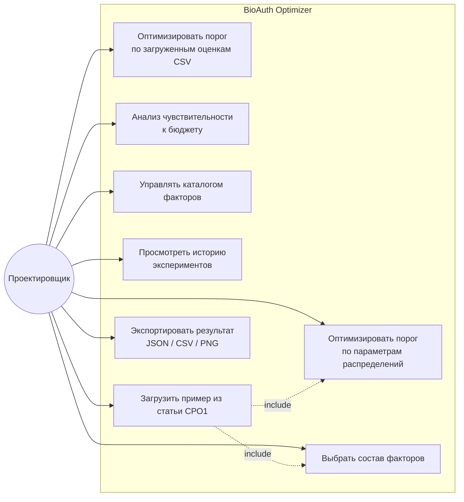

# 01. Постановка задачи и требования

## 1.1. Проблема

Параметры системы биометрической аутентификации на практике задают экспертно или по точке равных ошибок (EER). В СРО1 показано, что это субоптимально: при явных стоимостях ошибок порог нужно выбирать по минимуму байесовской стоимости, а состав факторов — решением целочисленной задачи с ограничениями на задержку, бюджет и нормативные требования (PAD, ISO/IEC 30107-3). Готового инструмента, который делает оба расчёта воспроизводимо и с понятной визуализацией, у проектировщика ИС нет.

## 1.2. Цель программного продукта

Веб-приложение, в котором проектировщик системы аутентификации:

1. задаёт распределения оценок сходства (параметрически или загрузкой данных) и стоимости ошибок, получает оптимальный порог и количественное сравнение с EER;
2. задаёт каталог факторов и ограничения, получает оптимальный состав факторов и анализ чувствительности к бюджету;
3. сохраняет и пересматривает эксперименты.

## 1.3. Пользователи и сценарии

| Роль                                    | Сценарий                                                                         |
| --------------------------------------- | -------------------------------------------------------------------------------- |
| Проектировщик ИС / инженер безопасности | Подбирает рабочую точку сравнителя под соотношение cFA/cFR своей организации     |
| Архитектор системы аутентификации       | Выбирает набор факторов (лицо, отпечаток, FIDO2, …) под SLA по задержке и бюджет |
| Преподаватель / комиссия (на защите)    | Нажимает «Загрузить пример из статьи» и видит, что результаты совпадают с СРО1   |

Аутентификация пользователей в самом приложении не требуется (однопользовательский прототип, см. ADR-0005).

## 1.4. Функциональные требования

### Модуль «Порог» (метод (1) из СРО1)

| ID    | Требование                                                                                                               |
| ----- | ------------------------------------------------------------------------------------------------------------------------ |
| FR-T1 | Ввод параметров нормальных распределений оценок: μ_G, σ_G (законные), μ_I, σ_I (злоумышленники); стоимостей cFA, cFR > 0 |
| FR-T2 | Загрузка CSV с эмпирическими оценками (колонки `score,label`, где label ∈ {genuine, impostor}); до 1 000 000 строк       |
| FR-T3 | Расчёт точки равных ошибок: τ_EER, FAR = FRR, E(τ_EER)                                                                   |
| FR-T4 | Расчёт оптимального порога τ\* = argmin E(τ), значения FAR, FRR, E в нём                                                 |
| FR-T5 | Относительное снижение потерь `Δ = 1 − E(τ*)/E(τ_EER)`                                                                   |
| FR-T6 | Необязательное ограничение FAR(τ) ≤ FAR_max (тогда ищется минимум E на допустимом множестве)                             |
| FR-T7 | Данные для графиков: FAR(τ), FRR(τ), E(τ) на логарифмической шкале (как рис. 2а СРО1) и ROC/DET-кривая                   |

### Модуль «Состав факторов» (метод (2)–(3) из СРО1)

| ID    | Требование                                                                                                                                                                                |
| ----- | ----------------------------------------------------------------------------------------------------------------------------------------------------------------------------------------- |
| FR-F1 | Каталог факторов: код, название, FAR_i ∈ (0,1), FRR_i ∈ [0,1), задержка l_i ≥ 0 мс, стоимость c_i ≥ 0, признак наличия PAD; 1 ≤ n ≤ 50 (точный перебор — при n ≤ 20, при большем n — ЦЛП) |
| FR-F2 | Ограничения: L_max, B, FAR_max, минимум факторов с PAD (по умолчанию 1); стоимости cFA, cFR                                                                                               |
| FR-F3 | Правило объединения «И»: FAR = ∏FAR_i, FRR = 1 − ∏(1 − FRR_i), задержка и стоимость суммируются                                                                                           |
| FR-F4 | Выбор решателя: `exhaustive` (точный перебор) или `ilp` (линеаризованное ЦЛП с сертификатом оптимальности, как предложено в СРО1); по умолчанию `auto`                                    |
| FR-F5 | Результат: оптимальный набор, его метрики, полный ранжированный список допустимых наборов, число допустимых / всех подмножеств, активные ограничения в оптимуме                           |
| FR-F6 | Анализ чувствительности: перебор B в заданном диапазоне с шагом, точки смены оптимума и «цена» ужесточения (во сколько раз растёт E)                                                      |
| FR-F7 | Если допустимых наборов нет — понятное сообщение с указанием, какое ограничение нарушается чаще всего                                                                                     |

### Общие

| ID    | Требование                                                                              |
| ----- | --------------------------------------------------------------------------------------- |
| FR-G1 | Кнопка «Пример из статьи СРО1» заполняет обе формы данными раздела 4                    |
| FR-G2 | Каждый запуск сохраняется как эксперимент (вход, результат, версия ядра, время расчёта) |
| FR-G3 | Просмотр истории экспериментов с фильтром по типу, повторное открытие результата        |
| FR-G4 | Экспорт результата в JSON и CSV, графиков — в PNG                                       |
| FR-G5 | CRUD каталогов факторов; предустановленный каталог F1–F5 из таблицы 2 СРО1              |

## 1.5. Нефункциональные требования

| ID                       | Требование                                                                                                                                          | Как проверяется                              |
| ------------------------ | --------------------------------------------------------------------------------------------------------------------------------------------------- | -------------------------------------------- |
| NFR-1 Точность           | Порог — абсолютная погрешность ≤ 1·10⁻⁹; вероятности в хвостах вплоть до 1·10⁻¹⁵ с относительной погрешностью ≤ 1·10⁻¹²                             | Золотые тесты против SciPy (07-testing)      |
| NFR-2 Корректность ЦЛП   | Решатели `exhaustive` и `ilp` возвращают одинаковое значение E (с точностью 10⁻¹²) на любой задаче с n ≤ 20                                         | Property-based тесты на 1000 случайных задач |
| NFR-3 Граничные случаи   | Нестрогие ограничения (`≤`) не ломаются из-за плавающей точки: набор F2+F4 с FAR = 5·10⁻⁵·2·10⁻² = 1·10⁻⁶ считается допустимым при FAR_max = 1·10⁻⁶ | Отдельный регрессионный тест (ADR-0008)      |
| NFR-4 Производительность | Параметрический порог < 50 мс; CSV 10⁶ строк < 3 с; ЦЛП n = 20 < 2 с                                                                                | Бенчмарки ядра                               |
| NFR-5 Детерминизм        | Одинаковый вход → побайтно одинаковый результат; при равенстве E — фиксированное правило разрешения ничьих                                          | Тесты                                        |
| NFR-6 Развёртывание      | `docker compose up` поднимает всё с нуля без ручных шагов                                                                                           | Smoke-тест в CI                              |
| NFR-7 Архитектура        | SOLID; FSD на фронтенде; ядро не зависит от NestJS/Next.js/БД                                                                                       | steiger (правила FSD) в CI, ревью            |
| NFR-8 Валидация          | Все входы проверяются одной zod-схемой и на фронтенде, и на бэкенде; ошибки — RFC 7807                                                              | Тесты контроллеров                           |
| NFR-9 Интерфейс          | Русский язык, адаптивная вёрстка, числа в научной нотации (5,0·10⁻¹¹), подсказки к формулам                                                         | Ручная проверка, e2e                         |

## 1.6. Вне рамок (осознанно)

Классы 2 и 3 из СРО1 (байесовская оптимизация гиперпараметров ArcFace, TRADES-обучение) требуют обучения нейросетей и GPU — для прототипа это избыточно. Метаэвристики для объединения трёх и более модальностей — кандидат на версию 2 (08-roadmap). Архитектура оставляет для них точку расширения: новый модуль и, при длительных задачах, очередь (ADR-0005).

## 1.7. Критерии приёмки

1. На примере из статьи модуль «Порог» выдаёт: τ_EER = 0,5310; FAR = FRR = 1,786 %; E(τ_EER) = 0,1965; τ*= 0,5818; FAR = 0,521 %; FRR = 6,230 %; E(τ*) = 0,1144; Δ = 41,8 %.
2. На примере из статьи модуль «Состав факторов» выдаёт: 6 допустимых из 31; оптимум F2+F5 (FAR = 5,0·10⁻¹¹; FRR = 1,9925 %; 650 мс; 2,1; E = 0,019925); при B = 2,0 — F1+F2 (E = 0,034700), рост E в 1,74 раза.
3. Оба решателя дают одинаковый результат.
4. `docker compose up` → приложение доступно на `http://localhost:3000`, Swagger — на `http://localhost:4000/api/docs`.

> **Примечание к статье СРО1.** В тексте статьи указано FAR ≈ FRR ≈ 1,77 % и E(τ_EER) = 0,195. Точный расчёт при заданных N(0,72; 0,09) и N(0,30; 0,11) даёт 1,786 % и 0,1965 (τ_EER = 0,531 получается точно — это ровно 2,1σ от обоих средних). Отсюда снижение 41,8 %, а не 41 %. Вывод статьи от этого не меняется, но система будет выдавать точные значения, и на защите стоит быть к этому готовым.
