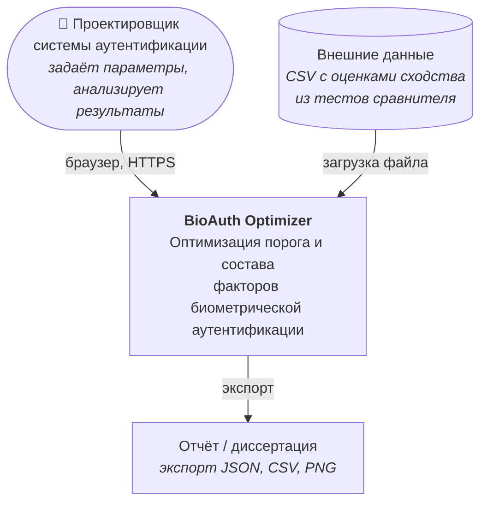
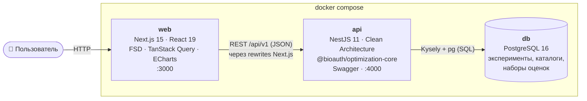
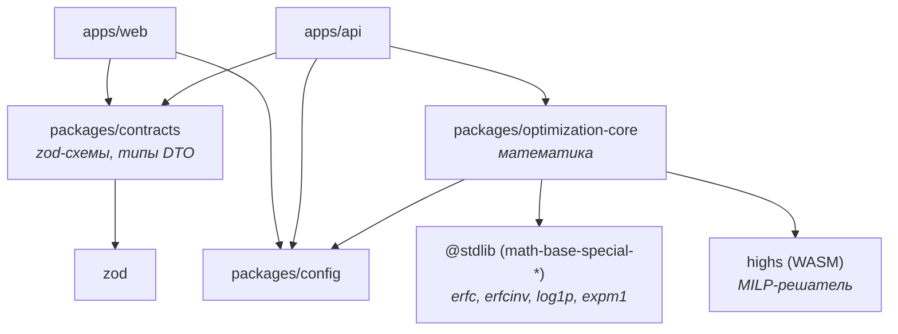
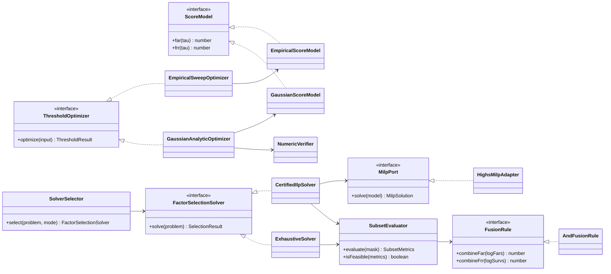
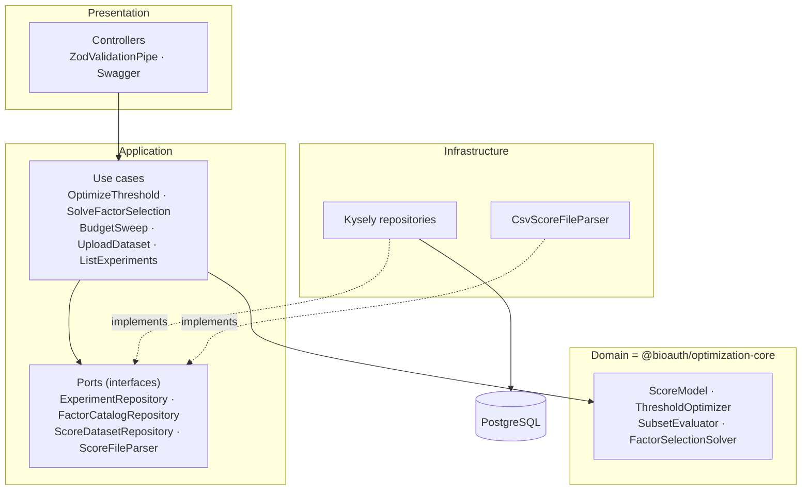
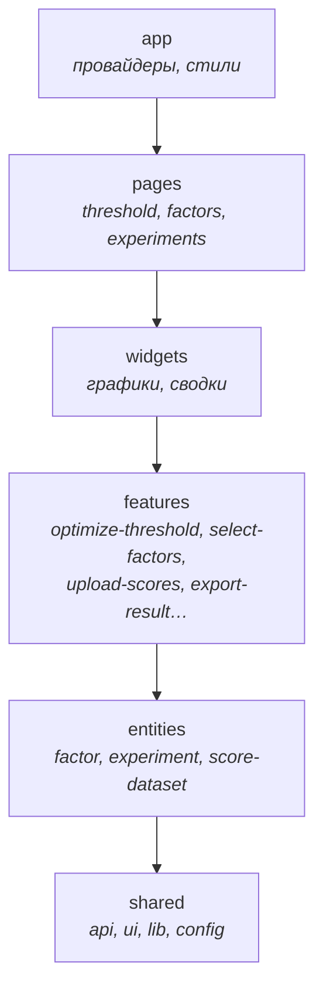
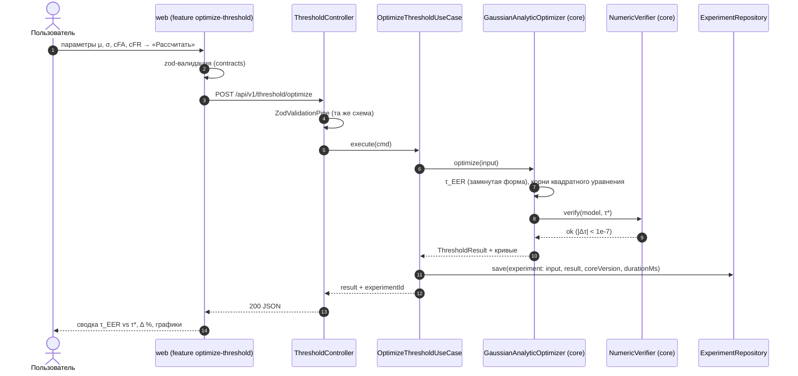
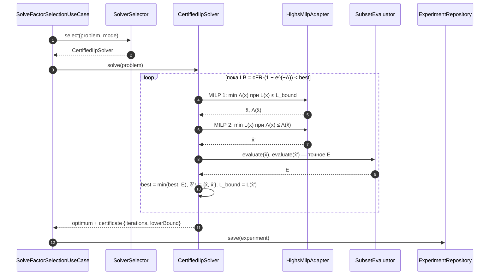
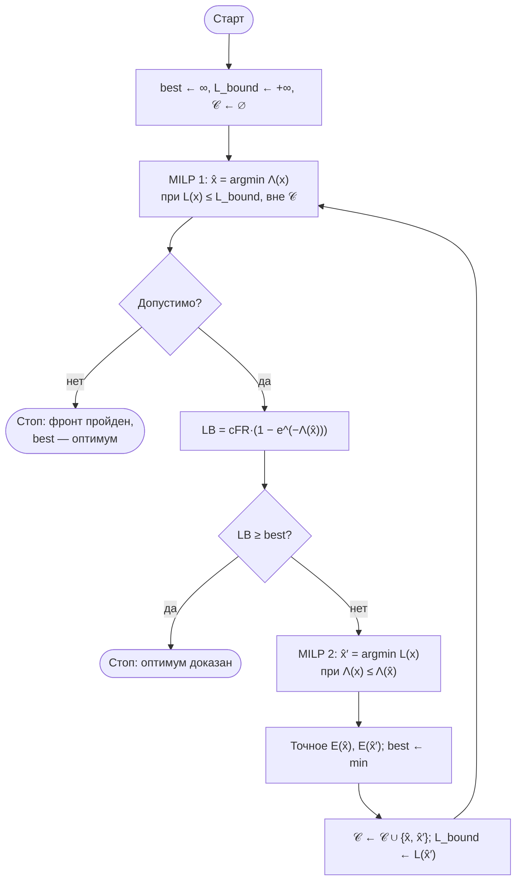

# 03. Архитектура

## 3.1. Архитектурный стиль

**Модульный монолит в монорепозитории** (ADR-0001). Три развёртываемых контейнера: `web` (Next.js), `api` (NestJS), `db` (PostgreSQL). Вся математика живёт в пакете `@bioauth/optimization-core`: чистый TypeScript без зависимостей от фреймворков, БД и HTTP (ADR-0002). Бэкенд — тонкая оболочка над ядром (валидация, сохранение, HTTP), фронтенд только отображает результаты и ничего не вычисляет (ADR-0009).

## 3.2. Контекст системы (C4, уровень 1)



## 3.3. Контейнеры (C4, уровень 2)



## 3.4. Пакеты монорепозитория и правила зависимостей



Правила закреплены в коде и ревью; правила FSD фронтенда проверяет `steiger` в CI:
- `optimization-core` не импортирует ничего из `apps/*`, `@nestjs/*`, `next`, `react`, `kysely`, `pg`.
- `web` не импортирует `optimization-core`: все вычисления выполняются на сервере, это единственный источник правды.
- `contracts` зависит только от `zod`.

## 3.5. Вычислительное ядро `@bioauth/optimization-core`

```
packages/optimization-core/src/
├── numeric/
│   ├── special-functions.ts   # обёртки @stdlib: erfc, erfcinv, log1p, expm1
│   ├── tolerance.ts           # leq(lhs, rhs, eps), EPS = 1e-9 (ADR-0008)
│   └── bisection.ts           # корень производной (верификация порога)
├── threshold/
│   ├── score-model.ts         # interface ScoreModel { far(τ); frr(τ) }
│   ├── gaussian-score-model.ts
│   ├── empirical-score-model.ts
│   ├── bayes-cost.ts          # E(τ) = cFA·FAR + cFR·FRR
│   ├── optimizers/
│   │   ├── threshold-optimizer.ts         # interface
│   │   ├── gaussian-analytic.optimizer.ts # 2.1.1
│   │   └── empirical-sweep.optimizer.ts   # 2.1.2
│   ├── verification/numeric-verifier.ts
│   └── curves.ts              # точки FAR/FRR/E и ROC для графиков
├── factor-selection/
│   ├── factor.ts, constraints.ts, selection.ts
│   ├── fusion/
│   │   ├── fusion-rule.ts     # interface FusionRule
│   │   └── and-fusion.rule.ts # правило «И» (СРО1)
│   ├── subset-evaluator.ts    # метрики + допустимость в лог-пространстве
│   ├── solvers/
│   │   ├── factor-selection-solver.ts     # interface
│   │   ├── exhaustive.solver.ts           # 2.2.2
│   │   ├── certified-ilp.solver.ts        # 2.2.3
│   │   ├── milp-port.ts                   # interface MilpPort
│   │   ├── highs-milp.adapter.ts          # реализация MilpPort на HiGHS
│   │   └── solver-selector.ts             # auto: n ≤ 20 → exhaustive
│   └── sensitivity/budget-sweep.ts
├── examples/article-sro1.ts   # данные раздела 4 СРО1
└── index.ts                   # публичный API (фасады)
```

### Диаграмма классов (ключевые абстракции)



## 3.6. Бэкенд: NestJS + Clean / Hexagonal Architecture

Каждый бизнес-модуль разделён на три слоя. Доменный слой — это само ядро `optimization-core` (сущности, формулы, решатели); в модулях хранения есть свои порты-репозитории (ADR-0003).

```
apps/api/src/
├── main.ts · app.module.ts
├── shared/
│   ├── config/            # валидация env через zod
│   ├── database/          # Kysely, мигратор SQL-файлов, migrate.cli (ADR-0011)
│   ├── http/              # ZodValidationPipe, ProblemDetailsFilter (RFC 7807), RequestIdMiddleware
│   ├── logging/           # pino, структурные логи с request_id
│   └── health/            # /health/live, /health/ready (проверка БД)
└── modules/
    ├── threshold/
    │   ├── presentation/  threshold.controller.ts
    │   ├── application/   optimize-threshold.use-case.ts
    │   └── threshold.module.ts        # привязка токена THRESHOLD_OPTIMIZERS → реализации из core
    ├── factor-selection/
    │   ├── presentation/  factor-selection.controller.ts
    │   ├── application/   solve-factor-selection.use-case.ts, budget-sweep.use-case.ts
    │   └── factor-selection.module.ts
    ├── factor-catalogs/
    │   ├── presentation/  factor-catalogs.controller.ts
    │   ├── application/   create/update/get/list use-cases, ports/factor-catalog.repository.ts
    │   └── infrastructure/kysely-factor-catalog.repository.ts
    ├── score-datasets/
    │   ├── presentation/  score-datasets.controller.ts (multipart)
    │   ├── application/   upload-dataset.use-case.ts, ports/score-dataset.repository.ts, ports/score-file-parser.ts
    │   └── infrastructure/csv-score-file.parser.ts (потоковый), kysely-score-dataset.repository.ts
    ├── experiments/
    │   ├── presentation/  experiments.controller.ts
    │   ├── application/   ports/experiment.repository.ts, experiment-recorder.ts, list/get use-cases
    │   └── infrastructure/kysely-experiment.repository.ts
    └── examples/          # GET пресетов статьи (данные из core/examples)
```



**Правило зависимостей:** стрелки направлены только внутрь. Use case знает интерфейс `ExperimentRepository`, но не знает Kysely. Подстановку реализаций делает `*.module.ts` через DI-токены NestJS.

## 3.7. Фронтенд: Next.js App Router + Feature-Sliced Design

FSD хорошо подходит для этого приложения: две независимые фичи (порог и факторы) с общими сущностями. Слои (ADR-0004):

```
apps/web/
├── app/                         # ТОЛЬКО маршрутизация Next.js: файлы page.tsx реэкспортируют src/pages/*
│   ├── layout.tsx · page.tsx
│   ├── threshold/page.tsx
│   ├── factors/page.tsx
│   └── experiments/[[...id]]/page.tsx
├── pages/README.md              # пустая папка, чтобы Next.js не считал src/pages роутером Pages Router
└── src/
    ├── app/                     # FSD app: провайдеры (QueryClient, тема), глобальные стили
    ├── pages/
    │   ├── home/  threshold/  factors/  experiments/
    ├── widgets/
    │   ├── threshold-error-chart/      # FAR/FRR/E, лог-шкала (рис. 2а)
    │   ├── roc-chart/
    │   ├── threshold-summary/          # карточки τ_EER vs τ*, Δ %
    │   ├── factor-ranking-chart/       # рейтинг допустимых наборов (рис. 2б)
    │   ├── factor-selection-summary/
    │   ├── budget-sensitivity-chart/
    │   └── experiments-table/
    ├── features/
    │   ├── optimize-threshold/         # форма + мутация POST /threshold/optimize
    │   ├── upload-scores/              # загрузка CSV
    │   ├── select-factors/             # форма ограничений + выбор решателя
    │   ├── edit-factor-catalog/
    │   ├── run-budget-sweep/
    │   ├── load-article-example/       # кнопка «Пример из статьи СРО1»
    │   └── export-result/              # JSON / CSV / PNG
    ├── entities/
    │   ├── factor/                     # model (тип из contracts), ui/FactorRow, api
    │   ├── factor-catalog/
    │   ├── experiment/
    │   └── score-dataset/
    └── shared/
        ├── api/                        # http-клиент (fetch + zod-парсинг ответов)
        ├── ui/                         # UI-кит: Button, поля, Panel, Notice, EChart
        ├── lib/format/                 # 5,0·10⁻¹¹, проценты, мс
        └── config/
```



**Правила FSD:** слой импортирует только нижележащие слои; слайсы одного слоя друг друга не импортируют; доступ к слайсу — только через его `index.ts` (public API). Проверяется линтером `steiger` (плагин `@feature-sliced/steiger-plugin`) в CI.

**Состояние:** серверное — TanStack Query (кэш результатов и истории); формы — локальное состояние в модели фичи (`use-*-form.ts`) и `safeParse` схемой из `@bioauth/contracts`; глобального стора нет.

## 3.8. Ключевые сценарии

### Оптимизация порога



### Выбор состава факторов (решатель `ilp`)



### Алгоритм ЦЛП с сертификатом (обход фронта Парето)



## 3.9. Соответствие принципам SOLID

| Принцип | Где и как соблюдается |
|---|---|
| **S** — единственная ответственность | `SubsetEvaluator` только считает метрики и допустимость; `ExhaustiveSolver` только перебирает; `ExperimentRecorder` только сохраняет; контроллер только переводит HTTP ↔ команду use case. На фронтенде фича `optimize-threshold` не рисует графики — это делает виджет |
| **O** — открытость/закрытость | Новый решатель (например, NSGA-II), правило объединения («ИЛИ») или модель оценок (бета-распределение) добавляется новой реализацией интерфейса `FactorSelectionSolver` / `FusionRule` / `ScoreModel` без правки существующего кода. `SolverSelector` получает реестр решателей через DI |
| **L** — подстановка Лисков | Любой `FactorSelectionSolver` возвращает `SelectionResult` с одинаковым контрактом (оптимум, допустимость, метаданные). Property-тест гоняет одну и ту же спецификацию на всех реализациях |
| **I** — разделение интерфейсов | `ScoreModel` содержит только `far/frr`; кривые строит отдельный `CurveBuilder`. Порты репозиториев узкие: `ExperimentRepository { save, findById, list }` без лишних методов |
| **D** — инверсия зависимостей | Use cases зависят от портов (`ExperimentRepository`, `MilpPort`), реализации (Kysely, HiGHS) подставляются через DI. `CertifiedIlpSolver` не знает о HiGHS: в тестах ему подставляется заглушка `MilpPort` |

## 3.10. Сквозные аспекты

- **Валидация.** Одна zod-схема из `@bioauth/contracts` используется в модели формы, в пайпе NestJS и для генерации OpenAPI (`z.toJSONSchema`).
- **Ошибки** — формат RFC 7807 `application/problem+json`: `validation-error` (400), `infeasible-problem` (422, с диагностикой нарушенных ограничений), `problem-too-large` (413), `not-found` (404), `internal-consistency-error` (500, если верификация не сошлась).
- **Логи** — pino, JSON, `request_id`, длительность расчёта, выбранный решатель, число итераций ЦЛП.
- **Версионирование ядра.** В каждый эксперимент пишется `coreVersion` из package.json ядра, чтобы старые результаты можно было воспроизвести.
