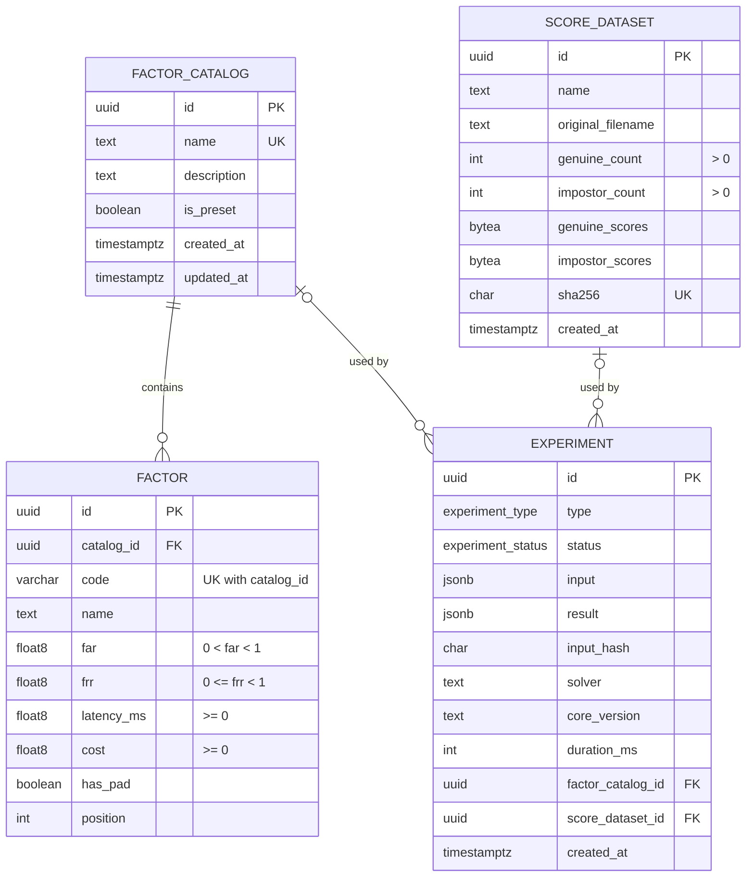
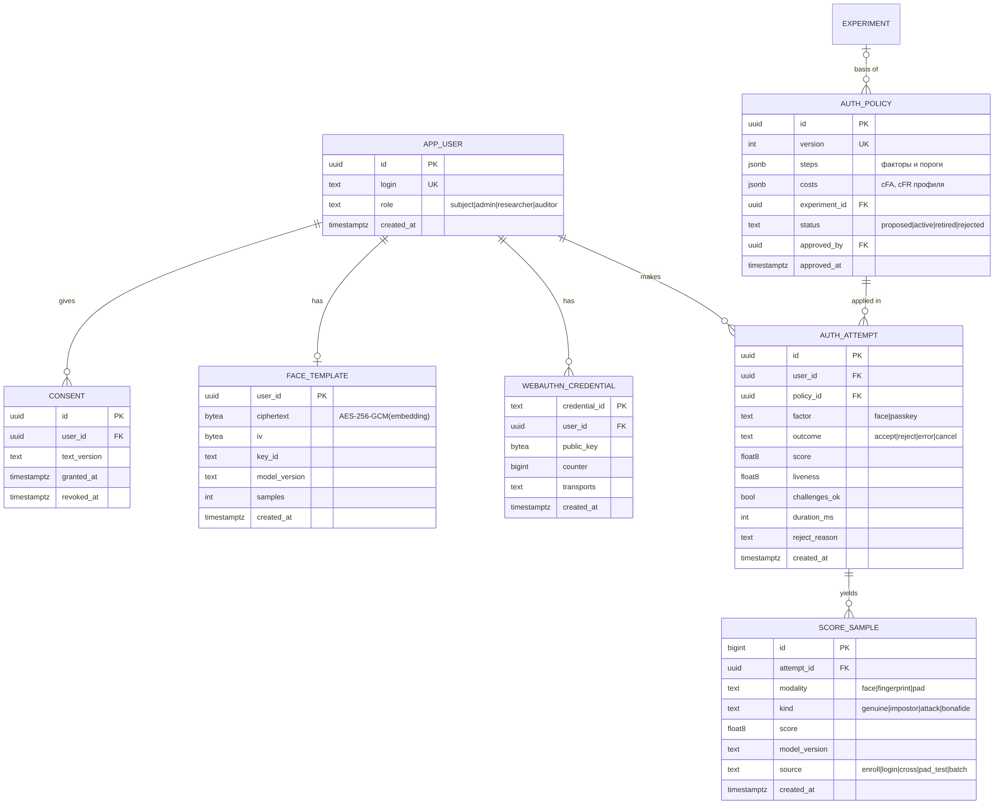
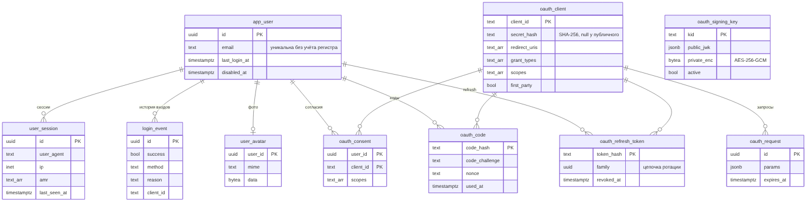

# 05. Модель данных (PostgreSQL 16, Kysely)

## 5.1. Принципы

- Эксперимент **неизменяем** и самодостаточен: полный вход (включая копию факторов, а не ссылку) и полный результат хранятся в `jsonb`. Если позже отредактировать каталог, история не изменится.
- Инварианты закреплены в схеме (`CHECK`, `NOT NULL`, `UNIQUE`), а не только в коде.
- Оценки сходства хранятся компактно, в `bytea` (Float64 little-endian): миллион оценок занимает 8 МБ, а не десятки мегабайт JSON.
- Мягкого удаления нет: каталоги удаляются физически, ссылки из экспериментов обнуляются (`ON DELETE SET NULL`).

## 5.2. ER-диаграмма



## 5.3. DDL (целевая схема первой миграции)

```sql
CREATE TYPE experiment_type   AS ENUM ('THRESHOLD', 'FACTOR_SELECTION', 'BUDGET_SWEEP');
CREATE TYPE experiment_status AS ENUM ('OK', 'INFEASIBLE');

CREATE TABLE factor_catalog (
  id          uuid PRIMARY KEY DEFAULT gen_random_uuid(),
  name        text NOT NULL UNIQUE CHECK (length(name) BETWEEN 1 AND 200),
  description text,
  is_preset   boolean NOT NULL DEFAULT false,
  created_at  timestamptz NOT NULL DEFAULT now(),
  updated_at  timestamptz NOT NULL DEFAULT now()
);

CREATE TABLE factor (
  id          uuid PRIMARY KEY DEFAULT gen_random_uuid(),
  catalog_id  uuid NOT NULL REFERENCES factor_catalog(id) ON DELETE CASCADE,
  code        varchar(16) NOT NULL,
  name        text NOT NULL,
  far         double precision NOT NULL CHECK (far > 0 AND far < 1),
  frr         double precision NOT NULL CHECK (frr >= 0 AND frr < 1),
  latency_ms  double precision NOT NULL CHECK (latency_ms >= 0),
  cost        double precision NOT NULL CHECK (cost >= 0),
  has_pad     boolean NOT NULL DEFAULT false,
  position    integer NOT NULL,
  UNIQUE (catalog_id, code)           -- заодно служит индексом по catalog_id
);

CREATE TABLE score_dataset (
  id                uuid PRIMARY KEY DEFAULT gen_random_uuid(),
  name              text NOT NULL,
  original_filename text NOT NULL,
  genuine_count     integer NOT NULL CHECK (genuine_count > 0),
  impostor_count    integer NOT NULL CHECK (impostor_count > 0),
  genuine_scores    bytea NOT NULL CHECK (octet_length(genuine_scores)  = genuine_count  * 8),
  impostor_scores   bytea NOT NULL CHECK (octet_length(impostor_scores) = impostor_count * 8),
  sha256            char(64) NOT NULL UNIQUE,          -- повторная загрузка того же файла не дублирует данные
  created_at        timestamptz NOT NULL DEFAULT now()
);

CREATE TABLE experiment (
  id                uuid PRIMARY KEY DEFAULT gen_random_uuid(),
  type              experiment_type   NOT NULL,
  status            experiment_status NOT NULL,
  input             jsonb NOT NULL,
  result            jsonb NOT NULL,
  input_hash        char(64) NOT NULL,                 -- sha256 канонического JSON входа
  solver            text,
  core_version      text NOT NULL,
  duration_ms       integer NOT NULL CHECK (duration_ms >= 0),
  factor_catalog_id uuid REFERENCES factor_catalog(id) ON DELETE SET NULL,
  score_dataset_id  uuid REFERENCES score_dataset(id)  ON DELETE SET NULL,
  created_at        timestamptz NOT NULL DEFAULT now()
);

CREATE INDEX experiment_type_created_idx ON experiment (type, created_at DESC, id DESC);  -- история с фильтром + keyset
CREATE INDEX experiment_input_hash_idx   ON experiment (input_hash);
CREATE INDEX experiment_catalog_idx      ON experiment (factor_catalog_id);
CREATE INDEX experiment_dataset_idx      ON experiment (score_dataset_id);
```

## 5.4. Начальные данные (seed)

Каталог `«СРО1 — модельный пример (табл. 2)»` с `is_preset = true` и факторами F1–F5 из [02-mathematical-model.md §2.3](02-mathematical-model.md). Seed идемпотентен (`upsert` по имени каталога).

## 5.5. Миграции

- SQL-миграции из `apps/api/migrations` применяет мигратор `migrate.cli.ts` при старте контейнера `api`, до запуска сервера (ADR-0011, 06-deployment).
- Миграции только вперёд; каждая следующая миграция должна быть совместима с кодом предыдущей версии (expand → migrate → contract).

## 5.6. Схема v2 (миграции 0002–0004)



| Миграция                   | Таблицы                                                                                                                                                   |
| -------------------------- | --------------------------------------------------------------------------------------------------------------------------------------------------------- |
| `0002_identity_biometrics` | `app_user`, `user_session`, `consent`, `face_template`, `webauthn_credential`, `auth_policy` (+ версия 1), `auth_session`, `auth_attempt`, `score_sample` |
| `0003_audit`               | `audit_event` + триггеры, запрещающие `UPDATE`, `DELETE`, `TRUNCATE`                                                                                      |
| `0004_calibration`         | `factor.provenance` (measured / declared / literature), `drift_alert`                                                                                     |

Инварианты в схеме, а не только в коде:

- ровно одна активная политика — частичный уникальный индекс по `status = 'active'`;
- шаблон лица — один на пользователя (`face_template.user_id` — первичный ключ), IV ровно 12 байт;
- оценки в `[−1, 1]`, `model_version NOT NULL` — оценки разных моделей не смешиваются при калибровке;
- источники оценок `enroll | login | cross | pad_test | batch`, виды `genuine | impostor | bonafide | attack`;
- уведомление о дрейфе — не более одного на политику и окно (`UNIQUE (policy_id, window_end)`);
- хэши аудита — 64 шестнадцатеричных символа, `hash` уникален.

Изображения лиц и эмбеддинги в открытом виде в БД не хранятся: только шифротекст шаблона и числовые оценки. При отзыве
согласия шаблон и passkey удаляются, у оценок обнуляется `user_id`.

## 5.7. Схема v3 (миграция 0005)



- `app_user`: `email` (уникальна без учёта регистра), `last_login_at`, `disabled_at`.
- `user_session`: `user_agent`, `ip`, `amr`, `last_seen_at` (обновляется не чаще раза в минуту).
- `login_event` — история входов: успех, способ, `amr`, причина отказа, IP, устройство, приложение OAuth.
- `user_avatar` — изображение и тип; формат проверен по сигнатуре.
- `oauth_client` — клиенты (хэш секрета SHA-256, адреса возврата, типы разрешений, scope); `oauth_request` — незавершённые
  запросы авторизации (10 мин); `oauth_code` — хэши кодов (60 с, одноразовые); `oauth_refresh_token` — хэши с цепочкой
  `family`; `oauth_consent` — согласия пользователя; `oauth_signing_key` — ключи подписи (закрытый — зашифрован, ровно один
  активный).

Токены и коды хранятся только в виде хэшей: утечка базы не даёт действующих токенов.
