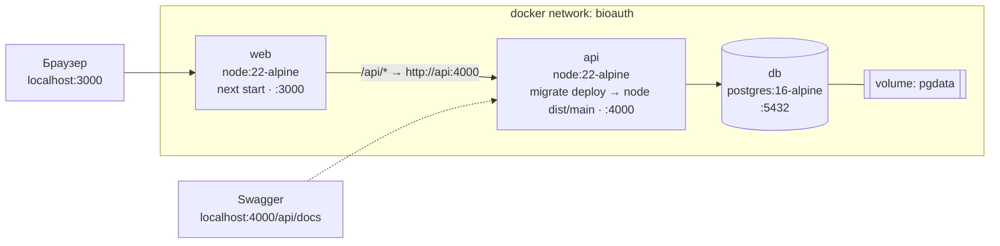

# 06. Развёртывание (Docker, docker-compose)

## 6.1. Схема развёртывания



Порядок запуска гарантируется `depends_on: condition: service_healthy`: db → api (миграции + seed, затем healthcheck `/health/ready`) → web.

## 6.2. docker-compose.yml (целевой)

```yaml
name: bioauth-optimizer

services:
  db:
    image: postgres:16-alpine
    environment:
      POSTGRES_DB: bioauth
      POSTGRES_USER: bioauth
      POSTGRES_PASSWORD: ${POSTGRES_PASSWORD:-bioauth}
    volumes: [pgdata:/var/lib/postgresql/data]
    healthcheck:
      test: ["CMD-SHELL", "pg_isready -U bioauth -d bioauth"]
      interval: 5s
      timeout: 3s
      retries: 10

  api:
    build: { context: ., dockerfile: docker/api.Dockerfile }
    environment:
      DATABASE_URL: postgresql://bioauth:${POSTGRES_PASSWORD:-bioauth}@db:5432/bioauth
      PORT: 4000
      CORS_ORIGIN: http://localhost:3000
      MAX_UPLOAD_MB: 50
      LOG_LEVEL: info
    ports: ["4000:4000"]
    depends_on:
      db: { condition: service_healthy }
    healthcheck:
      test: ["CMD", "wget", "-qO-", "http://localhost:4000/health/ready"]
      interval: 10s
      timeout: 3s
      retries: 10

  web:
    build: { context: ., dockerfile: docker/web.Dockerfile }
    environment:
      API_INTERNAL_URL: http://api:4000      # используется rewrites в next.config.ts
    ports: ["3000:3000"]
    depends_on:
      api: { condition: service_healthy }

volumes:
  pgdata:
```

## 6.3. Dockerfile'ы

Многоэтапная сборка с `turbo prune`, чтобы в образ попадали только нужные пакеты монорепо:

```dockerfile
# docker/api.Dockerfile (схема)
FROM node:22-alpine AS base
RUN corepack enable
WORKDIR /repo

FROM base AS pruner
COPY . .
RUN pnpm dlx turbo prune @bioauth/api --docker

FROM base AS builder
COPY --from=pruner /repo/out/json/ .
RUN pnpm install --frozen-lockfile
COPY --from=pruner /repo/out/full/ .
RUN pnpm turbo build --filter=@bioauth/api... && pnpm --filter @bioauth/api exec prisma generate
RUN pnpm deploy --filter=@bioauth/api --prod /app

FROM node:22-alpine AS runner
WORKDIR /app
COPY --from=builder /app .
USER node
EXPOSE 4000
CMD ["sh", "-c", "npx prisma migrate deploy && node dist/prisma/seed.js && node dist/main.js"]
```

`web.Dockerfile` устроен так же, но использует `output: "standalone"` в Next.js и запускает `node server.js`. Обе сборки работают от непривилегированного пользователя `node`.

## 6.4. Переменные окружения

| Переменная | Сервис | По умолчанию | Назначение |
|---|---|---|---|
| `DATABASE_URL` | api | — (обязательна) | Строка подключения Prisma |
| `PORT` | api | 4000 | Порт HTTP |
| `CORS_ORIGIN` | api | http://localhost:3000 | Разрешённый origin |
| `MAX_UPLOAD_MB` | api | 50 | Лимит размера CSV |
| `LOG_LEVEL` | api | info | Уровень логов pino |
| `API_INTERNAL_URL` | web | http://api:4000 | Адрес API для серверных rewrites |
| `POSTGRES_PASSWORD` | db, api | bioauth | Пароль БД (для локального запуска; в `.env`, не в git) |

Все переменные api валидируются zod-схемой при старте: без `DATABASE_URL` процесс завершается с понятной ошибкой.

## 6.5. Команды

```bash
docker compose up --build        # поднять всё
docker compose down -v           # остановить и удалить данные
pnpm install && pnpm dev         # локальная разработка (db можно поднять отдельно: docker compose up db)
pnpm test                        # все тесты через turbo
```
