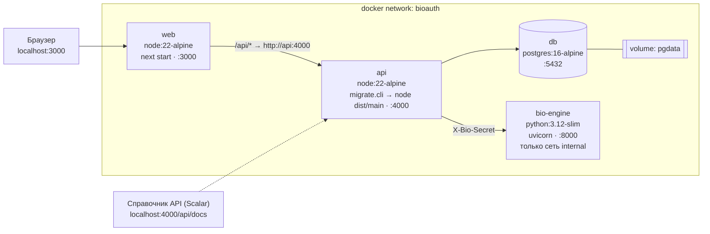

# 06. Развёртывание (Docker, docker-compose)

## 6.1. Схема развёртывания



Порядок запуска гарантируется `depends_on: condition: service_healthy`: db и bio-engine → api (миграции + seed, затем healthcheck `/health/ready`) → web. bio-engine подключён только к внутренней сети `internal` без выхода наружу, файловая система контейнера — только для чтения, модели лежат в образе (проверка SHA-256 при сборке).

## 6.2. Файлы

| Файл                                                                  | Назначение                                                                                          |
| --------------------------------------------------------------------- | --------------------------------------------------------------------------------------------------- |
| [`docker-compose.yml`](../docker-compose.yml)                         | Три сервиса: `db`, `api`, `web`; healthcheck'и и порядок запуска                                    |
| [`docker/api.Dockerfile`](../docker/api.Dockerfile)                   | Сборка API: `turbo prune` → `pnpm install --frozen-lockfile` → `turbo build` → `pnpm deploy --prod` |
| [`docker/web.Dockerfile`](../docker/web.Dockerfile)                   | Сборка интерфейса: Next.js `output: "standalone"`, запуск `node apps/web/server.js`                 |
| [`services/bio-engine/Dockerfile`](../services/bio-engine/Dockerfile) | Сервис распознавания: зависимости Python, загрузка моделей по `models.lock.json`, запуск uvicorn    |
| [`.dockerignore`](../.dockerignore)                                   | Исключает `node_modules`, `dist`, `.next`, `.git` и секреты                                         |

## 6.3. Как устроены образы

- **Многоэтапная сборка.** `turbo prune @bioauth/api --docker` оставляет в контексте только api и пакеты, от которых он зависит (`optimization-core`, `contracts`, `config`). Сначала копируются одни `package.json` и lockfile — слой с зависимостями кэшируется, пока они не меняются.
- **Продуктовый образ api** содержит только `dist`, `migrations` и production-зависимости (`pnpm deploy --prod`). При старте контейнера выполняется `node dist/shared/database/migrate.cli.js` (SQL-миграции и идемпотентный seed каталога СРО1, ADR-0011), затем `exec node dist/main.js`.
- **Образ web** — standalone-сборка Next.js. Адрес API для rewrites (`API_INTERNAL_URL=http://api:4000`) задаётся аргументом сборки, поэтому браузер обращается к `/api/*` на том же origin, и CORS не нужен.
- Оба процесса работают от непривилегированного пользователя `node`.
- **Проверено:** шаги обоих Dockerfile'ов (prune, установка по lockfile, сборка, deploy) и запуск получившихся сборок проверены на реальном PostgreSQL 16. Полный `docker compose up --build` и e2e-тесты против контейнеров выполняет CI (`.github/workflows/ci.yml`, задача `docker`).

## 6.4. Переменные окружения

| Переменная                 | Сервис       | По умолчанию                     | Назначение                                             |
| -------------------------- | ------------ | -------------------------------- | ------------------------------------------------------ |
| `DATABASE_URL`             | api          | — (обязательна)                  | Строка подключения PostgreSQL                          |
| `PORT`                     | api          | 4000                             | Порт HTTP                                              |
| `CORS_ORIGIN`              | api          | <http://localhost:3000>          | Разрешённый origin                                     |
| `MAX_UPLOAD_MB`            | api          | 50                               | Лимит размера CSV                                      |
| `LOG_LEVEL`                | api          | info                             | Уровень логов pino                                     |
| `API_INTERNAL_URL`         | web (сборка) | <http://api:4000>                | Адрес API для rewrites Next.js                         |
| `NEXT_PUBLIC_API_DOCS_URL` | web (сборка) | <http://localhost:4000/api/docs> | Ссылка «Документация API (Scalar)» в боковой панели    |
| `POSTGRES_PASSWORD`        | db, api      | bioauth                          | Пароль БД (для локального запуска; в `.env`, не в git) |

**v2 (живая биометрия):**

| Переменная                                   | Сервис          | По умолчанию                       | Назначение                                                                               |
| -------------------------------------------- | --------------- | ---------------------------------- | ---------------------------------------------------------------------------------------- |
| `BIO_ENGINE_URL`                             | api             | <http://localhost:8000>            | Адрес bio-engine                                                                         |
| `BIO_ENGINE_SECRET` / `BIO_SECRET`           | api, bio-engine | dev-bio-secret-change-me           | Общий секрет заголовка `X-Bio-Secret` (обязательно сменить вне демо)                     |
| `BIO_ENGINE_TIMEOUT_MS`                      | api             | 15000                              | Тайм-аут вызова bio-engine                                                               |
| `TEMPLATE_KEYS`, `TEMPLATE_ACTIVE_KEY`       | api             | —                                  | Ключи AES-256 шаблонов `{"k1":"<base64 32 байта>"}`; без них — только с `ALLOW_DEV_KEYS` |
| `TEMPLATE_CANCELABLE`                        | api             | true                               | Хранить отменяемую проекцию эмбеддинга (ADR-0014)                                        |
| `SESSION_TTL_HOURS`, `COOKIE_SECURE`         | api             | 12, авто                           | Срок сессии; флаг Secure cookie (по умолчанию — если RP_ORIGIN на https)                 |
| `RP_ID`, `RP_ORIGIN`                         | api             | localhost, <http://localhost:3000> | Relying Party WebAuthn — домен и origin интерфейса                                       |
| `ADMIN_LOGIN`, `ADMIN_PASSWORD`              | api             | admin, —                           | Первый администратор (создаётся при старте, если администраторов нет)                    |
| `REQUIRE_STAFF_PASSKEY`                      | api             | true                               | Требовать passkey вторым фактором сотрудника                                             |
| `AUTH_RATE_LIMIT_PER_MIN`                    | api             | 30                                 | Ограничение частоты запросов входа                                                       |
| `CROSS_IMPOSTOR_LIMIT`                       | api             | 50                                 | Сколько чужих шаблонов сравнивать с пробой попытки (impostor-оценки)                     |
| `PASSKEY_DECLARED_FAR`                       | api             | 2·10⁻⁵                             | Заявленный FAR passkey для измеренного каталога                                          |
| `DRIFT_CHECK_HOURS`, `DRIFT_WINDOW_DAYS`     | api             | 24, 7                              | Периодичность и окно проверки дрейфа FRR                                                 |
| `BATCH_MAX_BYTES`, `BATCH_TIMEOUT_MS`        | api             | 256 МБ, 30 мин                     | Пакетный режим: размер архива и время обработки                                          |
| `BIO_MAX_BATCH_BYTES`, `BIO_MAX_BATCH_FILES` | bio-engine      | 256 МБ, 5000                       | Лимиты архива в bio-engine (также `BIO_MAX_BATCH_UNPACKED_BYTES`)                        |

**v3 (сервер авторизации, PWA, SEO):**

| Переменная                    | Сервис       | По умолчанию          | Назначение                                                          |
| ----------------------------- | ------------ | --------------------- | ------------------------------------------------------------------- |
| `OIDC_ISSUER`                 | api          | `RP_ORIGIN`           | Идентификатор издателя токенов                                      |
| `OIDC_ACCESS_TOKEN_TTL_S`     | api          | 600                   | Срок токена доступа и ID-токена                                     |
| `OIDC_REFRESH_TOKEN_TTL_DAYS` | api          | 30                    | Срок refresh-токена                                                 |
| `OIDC_DEMO_CLIENT`            | api          | true                  | Создать публичный клиент `bioauth-demo` для страницы демо           |
| `NEXT_PUBLIC_SITE_URL`        | web (сборка) | `RP_ORIGIN` в compose | Публичный адрес для канонических ссылок, Open Graph и `sitemap.xml` |

Для реального домена: `RP_ORIGIN=https://bioauth.example.kz RP_ID=bioauth.example.kz make up` за обратным прокси с
сертификатом (камера, passkey и установка PWA работают только по HTTPS или на localhost).

Справочник API (Scalar) открывается на `http://localhost:4000/api/docs` и работает без интернета: его сборка входит в
образ api (ADR-0019).

Все переменные api валидируются zod-схемой при старте: без `DATABASE_URL` процесс завершается с понятной ошибкой.

## 6.5. Команды

Все команды собраны в `Makefile` (`make help` выводит список с описаниями):

```bash
make up              # собрать и поднять db, api, web; дождаться готовности
make health          # проверить api, БД, web и прокси web → api
make logs SERVICE=api
make down            # остановить (данные сохраняются)
make reset-db        # удалить данные (с подтверждением)

make setup           # окружение, зависимости, сборка пакетов
make db migrate      # только PostgreSQL на 127.0.0.1:55432 + миграции и seed
make dev             # api :4000 и web :3000 в режиме разработки
make check           # формат, линтер, типы, тесты (e2e API — на TEST_DATABASE_URL)
make smoke           # up + health + e2e в браузере
make release-zip     # архив исходников для сдачи
```
