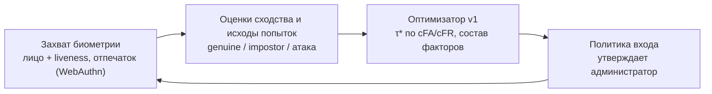

# 09. Анализ проекта и области применения

Документ отвечает на два вопроса: **что система умеет сейчас и где это полезно**, и **чего не хватает для реального использования**. Ответ на второй вопрос — техническое задание на модуль живой биометрии в [10-live-biometrics-spec.md](10-live-biometrics-spec.md).

## 9.1. Что представляет собой система сейчас (v1)

BioAuth Optimizer — **инструмент поддержки решений** для проектировщика системы биометрической аутентификации. Сам он никого не аутентифицирует: он отвечает на вопрос «как настроить систему аутентификации», а не «пустить ли этого человека».

| Возможность                | Метод (СРО1)                                            | Вход                                                          | Выход                                                                                        |
| -------------------------- | ------------------------------------------------------- | ------------------------------------------------------------- | -------------------------------------------------------------------------------------------- |
| Оптимальный порог          | Минимум байесовской стоимости (1)                       | Параметры распределений оценок или CSV с оценками; cFA, cFR   | τ\* против EER, выигрыш в ожидаемых потерях, кривые FAR/FRR/E, ROC                           |
| Состав факторов            | Целочисленное программирование (2)–(3) по фронту Парето | Каталог факторов (FAR, FRR, задержка, стоимость, PAD), лимиты | Оптимальный набор, рейтинг допустимых наборов, активные ограничения, доказательство оптимума |
| Чувствительность к бюджету | Перебор бюджета                                         | То же + диапазон бюджета                                      | Точки смены оптимума, «цена» ужесточения бюджета                                             |
| Доказательная база решений | Неизменяемые эксперименты                               | Любой расчёт                                                  | Вход, результат, версия ядра, время — для отчёта или аудита                                  |

### Сильные стороны

- **Точность и проверяемость.** Числа статьи воспроизводятся точно. Два независимых решателя сверяются на тысячах случайных задач, а аналитическое решение для порога подтверждается численно (07-testing).
- **Явная экономика ошибок.** Решение опирается на cFA/cFR конкретной организации, а не на «стандартный» EER. На примере статьи это снижает ожидаемые потери на 41,8 %.
- **Работает на данных пользователя.** Эмпирический режим принимает реальные оценки любого сравнителя: лица, отпечатка, голоса.
- **Инженерное качество:** контракты, тесты, CI с Docker и e2e, документация решений (ADR).

### Ограничения v1 — честно

| Ограничение                                                     | Следствие                                                                                        |
| --------------------------------------------------------------- | ------------------------------------------------------------------------------------------------ |
| Нет сбора биометрии: оценки и FAR/FRR факторов вводятся вручную | Результат хорош настолько, насколько хороши введённые числа («мусор на входе — мусор на выходе») |
| Параметры факторов берутся из литературы или паспорта вендора   | Реальные FRR и задержка в конкретной организации могут заметно отличаться                        |
| Найденный порог никуда не применяется                           | Нужен отдельный шаг, чтобы перенести τ\* в боевую систему                                        |
| Правило объединения только «И»                                  | Каскады и score-level fusion не моделируются (план v2/v3, 08-roadmap)                            |
| Нет пользователей, ролей и входа в само приложение              | Подходит для лаборатории и учебной защиты, но не для промышленной эксплуатации                   |

## 9.2. Кому и для каких решений это полезно

| Роль                                     | Решение, которое помогает принять                                           | Чем именно                                                           |
| ---------------------------------------- | --------------------------------------------------------------------------- | -------------------------------------------------------------------- |
| Архитектор / инженер ИБ                  | Какой порог выставить в сравнителе; какие факторы включить в политику входа | τ\* по cFA/cFR; оптимальный набор при SLA по задержке и бюджету      |
| Владелец продукта (банк, госуслуги, вуз) | Сколько стоит ужесточение требований; где выгоднее потратить бюджет         | Чувствительность к бюджету, сравнение наборов по ожидаемым потерям   |
| Специалист по закупкам / интегратор      | Какого вендора выбрать                                                      | Загрузка оценок каждого алгоритма из пилота (CSV) и сравнение E(τ\*) |
| Аудитор / служба комплаенс               | Обоснован ли выбранный порог                                                | Неизменяемый эксперимент: вход, результат, версия ядра, дата         |
| Исследователь, магистрант                | Как метод оптимизации меняет качество системы                               | Стенд с воспроизводимыми расчётами и экспортом для статей            |

## 9.3. Области применения

Числа в колонке «пример» — иллюстрации того, как задача ставится, а не измерения.

| Отрасль                                       | Задача                                                                                          | Модуль                                     | Пример постановки                                                                                                                            |
| --------------------------------------------- | ----------------------------------------------------------------------------------------------- | ------------------------------------------ | -------------------------------------------------------------------------------------------------------------------------------------------- |
| **Банки и МФО РК**                            | Порог сравнения лица при удалённой биометрии; набор факторов для входа и подтверждения операций | Порог, состав факторов                     | Ложный допуск при выдаче онлайн-кредита в сотни раз дороже ложного отказа: cFA/cFR = 200. Набор «лицо + liveness + FIDO2» при задержке ≤ 3 с |
| **Госуслуги (eGov)**                          | Вход и подписание по биометрии на массовой аудитории                                            | Порог                                      | Большой поток: цена ложного отказа (обращение в ЦОН) существенна — cFA/cFR ниже, чем в банке                                                 |
| **Образование (в т. ч. Университет «Туран»)** | Прокторинг онлайн-экзаменов, вход в LMS (Canvas), учёт посещаемости по лицу                     | Порог, состав факторов, эмпирический режим | cFA — цена прохождения экзамена за другого, cFR — сорванный экзамен студента. Задержка входа ≤ 5 с                                           |
| **СКУД и физический доступ**                  | Турникеты, серверные, лаборатории                                                               | Состав факторов                            | Турникет: задержка ≤ 1 с. Серверная: допустимы 3 фактора, ложный допуск недопустим (FAR_max = 10⁻⁷)                                          |
| **Здравоохранение**                           | Идентификация пациента, доступ врача к медицинской информационной системе                       | Порог, состав факторов                     | Ошибка идентификации пациента опасна: высокий cFA; врачу нужен быстрый вход: строгий лимит задержки                                          |
| **Корпоративный доступ (Zero Trust)**         | Step-up аутентификация: разный порог для разных операций                                        | Порог (несколько профилей стоимости)       | Просмотр почты: cFA = 5; перевод средств: cFA = 1000 — два профиля, два порога для одного сравнителя                                         |
| **Телеком, ЦОНы**                             | Верификация личности при выдаче SIM-карты или услуги                                            | Порог                                      | Мошенничество с SIM-картами дорого — высокий cFA, но очередь в офисе ограничивает число попыток                                              |
| **Вендоры и интеграторы**                     | Сравнение алгоритмов на пилоте, обоснование ТЗ                                                  | Эмпирический режим, история                | Загрузка оценок двух алгоритмов на одной выборке; у кого меньше E(τ\*) при cFA/cFR заказчика                                                 |
| **Наука**                                     | Стенд для диссертации «Разработка методов биометрической аутентификации»                        | Все                                        | Сравнение методов выбора порога и состава факторов на открытых наборах данных                                                                |

### Правовой контекст Республики Казахстан

- **Финансовый сектор.** В 2026 году АРРФР и Национальный банк обновили правила биометрической проверки ([Kazinform](https://www.inform.kz/ru/novie-pravila-biometricheskoy-proverki-vvodyat-v-bankah-i-mikrofinorganizatsiyah-kazahstana-b711e7), [Kazinform](https://www.inform.kz/ru/litso-vmesto-parolya-novie-pravila-biometrii-vstupayut-vsilu-vkazahstane-0efbe7cb)). Правила требуют:
  - сравнения изображения лица с эталоном из государственной базы;
  - не менее трёх случайных команд проверки «живости», при этом после трёх неудачных попыток проверка считается непройденной;
  - защиты от эмуляторов и подмены камеры;
  - электронного протокола каждой проверки, подписанного ЭЦП провайдера.

  Окончательное решение принимает финансовая организация по своим внутренним критериям — то есть порог и политика остаются её ответственностью. Именно эту задачу решает система.

- **Персональные данные.** Биометрические данные — чувствительная категория персональных данных по Закону РК «О персональных данных и их защите». Закон требует согласия субъекта до сбора, ограничения цели и объёма, предусматривает требования к трансграничной передаче и хранению на территории РК ([zakon.kz](https://www.zakon.kz/stati/6408976-biometricheskie-personalnye-dannye-zashchishcheny-li-kazakhstantsy.html)). Модуль живой биометрии (документ 10) спроектирован с учётом этих норм. Перед промышленным внедрением требования нужно сверить с актуальной редакцией закона и юристом.

## 9.4. Пример: как банк использует систему

1. Отдел рисков оценивает стоимости ошибок: средний ущерб от мошеннического кредита и стоимость отказа законному клиенту (ушёл к конкуренту, обратился в отделение). Пусть cFA/cFR = 200.
2. Вендор передаёт оценки сравнителя с пилота: 50 000 законных пар и 2 000 000 пар злоумышленников. Их загружают CSV-файлом.
3. Система показывает ожидаемые потери при EER-пороге и при τ\*, относительный выигрыш и интервал порогов, на котором решения одинаковы. Если выборки злоумышленников не хватает, чтобы подтвердить заявленный FAR (правило трёх), она об этом предупреждает.
4. Архитектор задаёт каталог факторов (лицо + liveness, отпечаток, FIDO2, SMS-код) с лимитами «задержка ≤ 3 с, бюджет на клиента, FAR ≤ 10⁻⁶, PAD ≥ 1» и получает оптимальный набор и цену ужесточения бюджета.
5. Эксперименты экспортируются в отчёт для комитета и аудитора.

**Узкое место этого сценария — шаги 2 и 4:** данные приходят извне и вручную. Поэтому следующий шаг развития — собирать оценки и параметры факторов в самой системе.

## 9.5. Чего не хватает для реального использования

| Разрыв                                     | Что нужно                                                                                                         | Где спроектировано                |
| ------------------------------------------ | ----------------------------------------------------------------------------------------------------------------- | --------------------------------- |
| Биометрия не собирается                    | Захват лица с камеры, liveness, сравнение; отпечаток через платформенный аутентификатор (Touch ID, Windows Hello) | 10 §10.4–10.6, ADR-0012, ADR-0013 |
| FAR/FRR/задержка факторов вводятся вручную | Измерение по реальным попыткам; автоматический «измеренный каталог» факторов                                      | 10 §10.7, ADR-0015                |
| Порог не применяется                       | Версионируемая политика входа: τ для каждого фактора и состав факторов; утверждение администратором               | 10 §10.7, ADR-0015                |
| Нет защиты биометрических данных           | Согласие, шифрование шаблонов, запрет хранения изображений, удаление по запросу, аудит                            | 10 §10.10, ADR-0014               |
| Нет пользователей и ролей                  | Пользователи, роли «субъект / администратор безопасности / аудитор»                                               | 10 §10.3, §10.8                   |
| Нет измерения устойчивости к атакам        | Протокол испытаний PAD (APCER/BPCER по ISO/IEC 30107-3) и качества сравнения (ISO/IEC 19795-1)                    | 10 §10.11                         |

## 9.6. Вывод

v1 решает **задачу проектирования**: корректно, проверяемо и на реальных оценках. Чтобы система стала **инструментом эксплуатации**, ей нужен собственный источник данных. Предлагаемое направление v2 — **замкнутый контур «измерить → оптимизировать → применить»**:

Методы СРО1 при этом не меняются, меняется только источник чисел: вместо литературных значений — измеренные на своих пользователях. Именно так статья рекомендует выбирать рабочую точку («по минимуму взвешенной стоимости при явно заданном отношении cFA/cFR»), а состав факторов — «целочисленным программированием с ограничениями на задержку, стоимость и нормативные требования».
