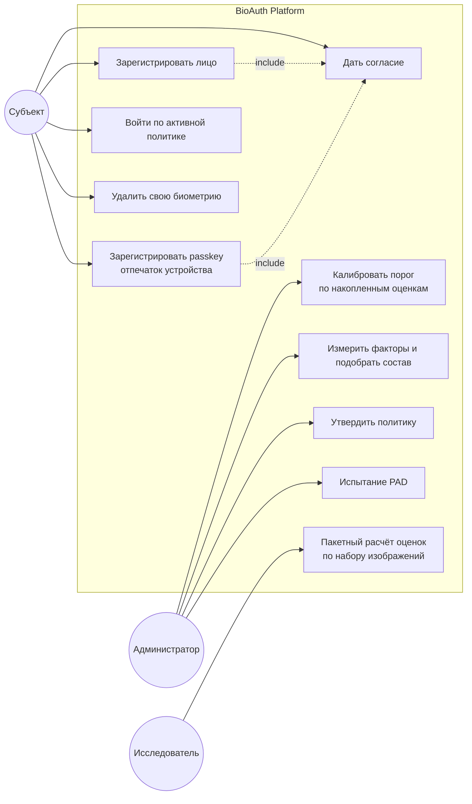
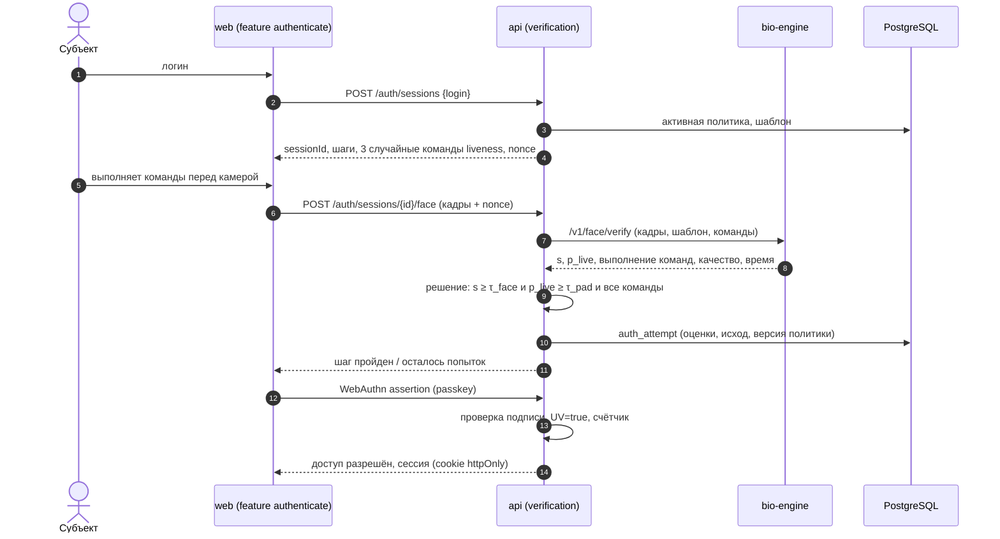
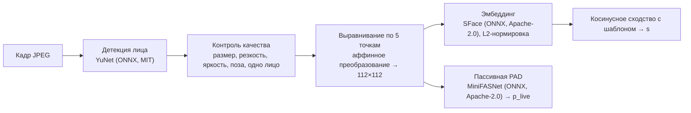
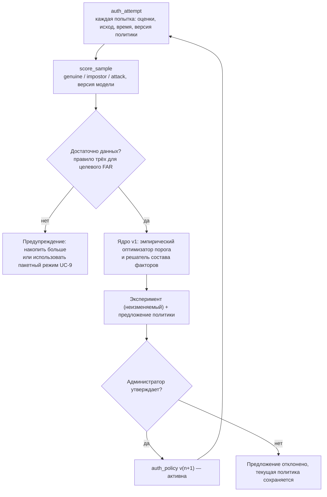
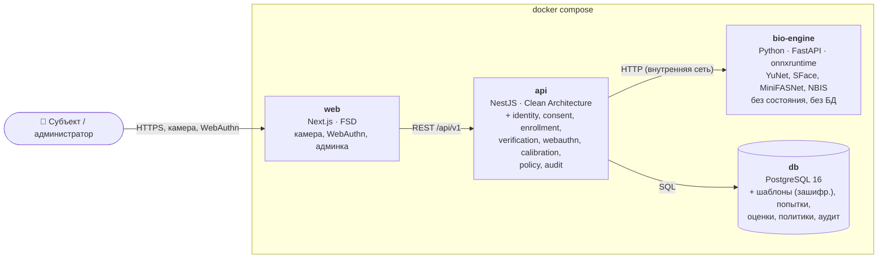
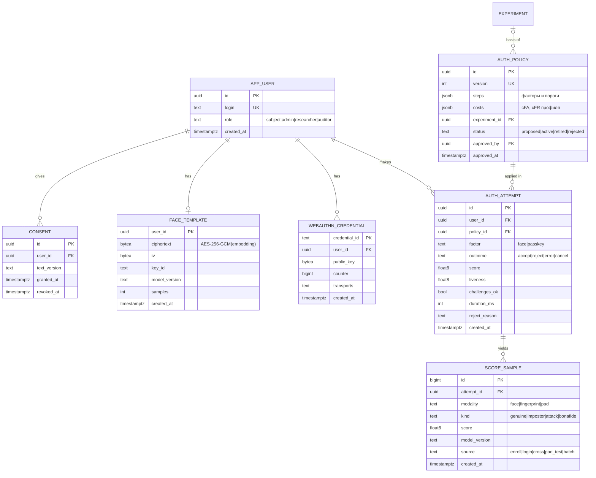

# 10. Техническое задание: модуль живой биометрии и замкнутый контур калибровки (v2)

|           |                                                                                                                                                                                                    |
| --------- | -------------------------------------------------------------------------------------------------------------------------------------------------------------------------------------------------- |
| Статус    | Проект к реализации                                                                                                                                                                                |
| Основание | Анализ применимости ([09-applicability.md](09-applicability.md)), статья СРО1                                                                                                                      |
| Решения   | [ADR-0012](adr/0012-bio-engine-onnx.md), [ADR-0013](adr/0013-fingerprint-webauthn-nbis.md), [ADR-0014](adr/0014-biometric-template-protection.md), [ADR-0015](adr/0015-closed-loop-calibration.md) |

## 10.1. Назначение и цели

Добавить в BioAuth Optimizer **реальную биометрическую аутентификацию** и замкнуть цикл, который в v1 был разорван:

1. **Измерить.** Система сама снимает лицо с камеры (с проверкой «живости»), принимает подтверждение отпечатком через платформенный аутентификатор (Touch ID, Windows Hello, сканер Android) и сохраняет оценки сходства и исходы попыток.
2. **Оптимизировать.** Накопленные оценки и измеренные FAR/FRR/задержка подаются в существующее вычислительное ядро: порог по формуле (1), состав факторов по формулам (2)–(3) СРО1.
3. **Применить.** Результат становится **версионируемой политикой входа**, которую утверждает администратор. По этой политике система аутентифицирует пользователей — в том числе при входе в само приложение.

**Критерий успеха:** на защите студент регистрирует лицо и отпечаток, входит в систему, затем администратор запускает калибровку на накопленных попытках, утверждает новый порог — и следующий вход идёт уже по нему. Всё это видно в интерфейсе и истории экспериментов.

**Вне рамок v2:** интеграция с НСБА и государственными базами эталонов; сертификация PAD; промышленные USB-сканеры отпечатков (интерфейс заложен, реализация — v3); мобильные приложения.

## 10.2. Термины

| Термин                                | Значение                                                                                              |
| ------------------------------------- | ----------------------------------------------------------------------------------------------------- |
| Субъект                               | Человек, который регистрирует биометрию и проходит аутентификацию                                     |
| Регистрация (enrollment)              | Получение и сохранение эталона (шаблона) субъекта                                                     |
| Шаблон                                | Вектор признаков лица (эмбеддинг), по которому выполняется сравнение; изображения не хранятся         |
| Оценка сходства s                     | Косинусное сходство эмбеддингов ∈ [−1; 1]; допуск при s ≥ τ                                           |
| Genuine / impostor                    | Сравнение субъекта с его собственным шаблоном / с чужим шаблоном                                      |
| PAD, liveness                         | Обнаружение атак на предъявление (фото, экран, маска); «живость»                                      |
| APCER / BPCER                         | Доля атак, принятых за живое лицо / доля живых лиц, отвергнутых как атака (ISO/IEC 30107-3)           |
| FTE / FTA                             | Отказ в регистрации / отказ в захвате (ISO/IEC 19795-1)                                               |
| Passkey, платформенный аутентификатор | Ключ FIDO2/WebAuthn, который разблокируется биометрией устройства (отпечаток, Face ID, Windows Hello) |
| Политика входа                        | Версионируемый набор: какие факторы обязательны и с какими порогами                                   |

## 10.3. Роли

| Роль                       | Права                                                                                         |
| -------------------------- | --------------------------------------------------------------------------------------------- |
| Субъект                    | Дать или отозвать согласие; зарегистрировать лицо и passkey; входить; удалить свою биометрию  |
| Администратор безопасности | Калибровка, утверждение политик, просмотр попыток (без биометрии), управление пользователями  |
| Исследователь              | Загрузка наборов изображений для пакетного расчёта оценок; доступ к анонимизированным оценкам |
| Аудитор                    | Только чтение: журнал аудита, история политик и экспериментов                                 |

Первый администратор создаётся при запуске (переменные окружения); остальные роли назначает администратор.

## 10.4. Сценарии использования

### UC-1. Согласие

Перед первым захватом субъект видит текст согласия: какие данные (эмбеддинг лица; для passkey — только открытый ключ), цель (аутентификация и калибровка), срок хранения, право отзыва, отсутствие трансграничной передачи. Согласие фиксируется с версией текста и временем. Без согласия захват невозможен.

### UC-2. Регистрация лица

1. Браузер включает камеру (`getUserMedia`, только по действию пользователя) и показывает рамку-подсказку.
2. Клиент отбирает **5 кадров** с подсказками «прямо», «чуть левее», «чуть правее» и отправляет их на сервер (JPEG, длинная сторона ≤ 640 px, по TLS).
3. Сервер (bio-engine) для каждого кадра: находит лицо, проверяет качество (§10.5.2), выравнивает, вычисляет эмбеддинг и оценку «живости».
4. Если годных кадров меньше трёх — отказ в регистрации (FTE) с понятной причиной: «слишком темно», «лицо не в кадре», «закройте лишние лица».
5. Шаблон = нормированное среднее годных эмбеддингов; он шифруется и сохраняется (ADR-0014). Кадры **не сохраняются**.
6. Попарные сходства кадров регистрации сохраняются как genuine-оценки для калибровки.

### UC-3. Регистрация passkey (отпечаток устройства)

Стандартная церемония WebAuthn registration с `authenticatorAttachment: "platform"` и `userVerification: "required"`. Сервер хранит идентификатор ключа, открытый ключ, счётчик подписей и тип транспорта. Отпечаток **не покидает устройство**: его сверяет защищённый модуль устройства (Secure Enclave, TPM).

### UC-4. Вход по активной политике

Политика задаёт обязательные шаги, например `face(τ=0,41) + liveness(τ_pad=0,62) + passkey`.

- **Попытки:** не более 3 на шаг (как в правилах АРРФР); затем блокировка входа на 15 минут и запись в аудит.
- **Порядок шагов** — из политики; более дешёвые и быстрые идут первыми.
- При отказе субъект видит причину без утечки порогов: «не удалось подтвердить лицо», «проверка живости не пройдена», «попробуйте при лучшем освещении».

### UC-5. Удаление биометрии

Субъект или администратор удаляет шаблон лица и passkey. Удаление **физическое**; оценки калибровки, связанные с субъектом, обезличиваются (subject_id → NULL). Отзыв согласия запускает то же удаление.

### UC-6. Калибровка порога (замкнутый контур)

1. Администратор выбирает модальность (лицо), модель (версия SFace), период и источник оценок.
2. Система формирует набор: genuine — регистрационные пары и подтверждённые входы (вход, подтверждённый вторым фактором); impostor — перекрёстные сравнения каждого свежего образца с шаблонами **других** субъектов.
3. Набор передаётся в существующий эмпирический оптимизатор (v1, §2.1.2) с cFA/cFR профиля политики.
4. Результат — предложение: новый τ\*, ожидаемые потери при текущем и новом пороге и относительный выигрыш. Если выборка мала, показывается предупреждение (правило трёх).
5. Администратор утверждает предложение → создаётся новая версия политики. Автоматического применения нет (ADR-0015).

### UC-7. Измерение факторов и выбор состава

Из журнала попыток вычисляются **измеренные** параметры каждого фактора:

- FRR — доля неуспешных genuine-попыток;
- FAR — на перекрёстных сравнениях для лица; для passkey — паспортное значение платформы (Apple указывает для Touch ID 1:50 000), потому что WebAuthn не раскрывает оценки;
- задержка — p95 длительности шага;
- стоимость — из настроек.

Так формируется каталог «Измеренный (дата)», который передаётся в существующий решатель состава факторов. Результат — предложение новой политики.

### UC-8. Испытание PAD

Администратор проводит сессию испытаний: живые попытки и атаки (распечатанное фото, фото или видео на экране телефона, видео на мониторе), помечая каждую. Система считает APCER и BPCER по ISO/IEC 30107-3 и подбирает порог τ_pad тем же оптимизатором, где cFA — цена принятой атаки, а cFR — цена ложного отказа живому человеку.

### UC-9. Пакетный расчёт оценок (исследовательский режим)

Исследователь загружает архив изображений со структурой `subject_id/xxx.jpg` (например, LFW для лиц или FVC2002/2004 для отпечатков, с соблюдением их лицензий). bio-engine считает все genuine-пары и выборку impostor-пар и формирует CSV `score,label`. Его можно сразу отправить в режим «Свои оценки» v1. Изображения обрабатываются в памяти и не сохраняются.

**Реализация (лица).** `POST /api/v1/calibration/batch` (роли admin, researcher; multipart: `file`, `name`, `seed`, `maxImpostor`, `includeInCalibration`) запускает фоновую задачу; `GET /api/v1/calibration/batch/{id}` — состояние, `DELETE` — отмена, `GET …/{id}/csv` — CSV `score,label`. bio-engine `POST /v1/batch/face` (тело — zip, лимит `BIO_MAX_BATCH_BYTES`, до `BIO_MAX_BATCH_FILES` файлов, фактический распакованный объём ограничен `BIO_MAX_BATCH_UNPACKED_BYTES`) строит эмбеддинг лица с наибольшей уверенностью детектора на каждом изображении; файлы без лица пропускаются с причиной. Протокол пар: все genuine-пары; impostor — все пары разных субъектов, если их не больше `maxImpostor`, иначе равномерная выборка без повторов генератором PCG64 с `seed` (одинаковые архив и seed дают одинаковый CSV). Результат сохраняется как набор оценок v1 (тот же модуль и формат), по флажку — и в `score_sample` с источником `batch`; запуск записывается в журнал аудита (`batch.scored`).

**Допустимые наборы.** Сами наборы в репозиторий не кладутся. Перед использованием проверяется лицензия: LFW (University of Massachusetts) распространяется для исследований без явной лицензии; CelebA — только некоммерческие исследования; наборы с отозванным распространением (например, MS-Celeb-1M, VGGFace2) не используются. Для внутреннего испытания годится собственный набор участников, давших согласие по форме §10.11. Отпечатки (FVC2002/2004, NBIS) — следующий шаг: адаптер NBIS требует сборки mindtct/bozorth3 в образе bio-engine.

## 10.5. Алгоритмы: лицо

### 10.5.1. Конвейер

Модели исполняются в отдельном сервисе **bio-engine** (Python, FastAPI, onnxruntime, OpenCV) — ADR-0012. Модели и их версии фиксируются в образе. Версия модели пишется в каждый шаблон и в каждую оценку: оценки разных версий модели **не смешиваются** при калибровке.

### 10.5.2. Контроль качества кадра

| Проверка  | Правило (начальные значения, калибруются по FTA)                    | Сообщение пользователю           |
| --------- | ------------------------------------------------------------------- | -------------------------------- |
| Число лиц | ровно одно с уверенностью ≥ 0,9                                     | «В кадре должно быть одно лицо»  |
| Размер    | межзрачковое расстояние ≥ 60 px                                     | «Подойдите ближе к камере»       |
| Резкость  | дисперсия лапласиана ≥ 60                                           | «Изображение размыто»            |
| Яркость   | средняя яркость лица 60…200 из 255                                  | «Слишком темно / слишком светло» |
| Поза      | \|yaw\| ≤ 25°, \|pitch\| ≤ 20°, \|roll\| ≤ 20° (кроме шагов-команд) | «Смотрите прямо в камеру»        |

### 10.5.3. Проверка «живости»: пассивная + активная

- **Пассивная:** MiniFASNet даёт вероятность живого лица p_live для каждого кадра; решение — медиана по кадрам ≥ τ_pad.
- **Активная:** сервер выдаёт **3 случайные команды** из восьми (с версии 3.2; ранее — из четырёх). Каждая проверяется по 5 ключевым точкам YuNet **относительно нейтральных кадров** того же человека, а не по абсолютному углу:

  | Команда                    | Что измеряется                                          | Порог                     |
  | -------------------------- | ------------------------------------------------------- | ------------------------- |
  | `TURN_LEFT`, `TURN_RIGHT`  | смещение носа от середины глаз, в долях расстояния глаз | Δ ≥ 0,10                  |
  | `CHIN_UP`                  | отношение (глаза–нос)/(нос–рот)                         | ≤ 0,88 исходного          |
  | `CHIN_DOWN`                | то же отношение                                         | ≥ 1,14 исходного          |
  | `TILT_LEFT`, `TILT_RIGHT`  | наклон головы к плечу — угол линии глаз                 | Δ ≥ 10°                   |
  | `MOVE_CLOSER`, `MOVE_AWAY` | межзрачковое расстояние                                 | ≥ 1,18 и ≤ 0,85 исходного |

  Поворот и подбородок считаются в системе координат лица (ключевые точки доворачиваются на угол линии глаз), поэтому наклон к плечу не засчитывается как поворот головы. Последовательность случайна для каждой сессии (криптографический ГСЧ, 336 упорядоченных троек) и связана с nonce: повтор записанного видео не проходит.

- **Согласованность личности:** все кадры попытки должны принадлежать одному человеку (попарное сходство ≥ 0,6), иначе отказ («подмена лица во время проверки»).

Такая проверка соответствует требованию «не менее трёх случайных команд» из правил финансового регулятора РК, но **не является сертифицированной PAD**. Её фактическая устойчивость измеряется испытанием UC-8, а ограничения перечислены в §10.13.

### 10.5.4. Решение по лицу

`accept = (s ≥ τ_face) ∧ (median p_live ≥ τ_pad) ∧ (все 3 команды выполнены) ∧ (согласованность личности)`.

Это правило «И» из статьи СРО1, применённое внутри одного фактора; τ_face и τ_pad берутся из активной политики.

**Начальные значения** до первой калибровки: τ_face = 0,363 — порог косинусного сходства SFace из примера распознавания лиц OpenCV (`samples/dnn/face_detect`); τ_pad = 0,5. Оба помечены в интерфейсе как «не откалиброваны».

## 10.6. Алгоритмы: отпечаток

Браузер не предоставляет веб-приложению доступ к сканеру отпечатков. Поэтому реальные отпечатки используются двумя способами (ADR-0013):

| Способ                                                                                                         | Что даёт                                                                                                                 | Ограничение                                                                                                                |
| -------------------------------------------------------------------------------------------------------------- | ------------------------------------------------------------------------------------------------------------------------ | -------------------------------------------------------------------------------------------------------------------------- |
| **A. Passkey с платформенным аутентификатором** (Touch ID, Windows Hello, сканер Android) — основной для входа | Реальная проверка отпечатка на устройстве; сервер получает криптографическое подтверждение (подпись, флаг UV)            | Оценки сходства недоступны; при сбое устройство может предложить PIN — веб-приложение не различает, чем выполнена проверка |
| **B. Изображения отпечатков** (наборы FVC или снимки со сканера) — исследовательский режим                     | Оценки сходства NBIS (mindtct + bozorth3, общественное достояние) → калибровка порога для дактилоскопического сравнителя | Нужен источник изображений; сканер подключается в v3 через локальный агент (порт `FingerprintScannerPort` заложен)         |

Для каталога факторов отпечаток через passkey описывается так:

- FAR — паспортное значение платформы;
- FRR — измеренная доля неуспешных церемоний (отмена или `NotAllowedError` без повторного успеха);
- задержка — измеренная длительность церемонии;
- признак PAD — по документации платформы.

## 10.7. Замкнутый контур калибровки

**Источники genuine-оценок:** пары кадров регистрации; входы, подтверждённые вторым фактором; контролируемые сессии испытаний.

**Источники impostor-оценок:** перекрёстное сравнение образца каждой попытки с шаблонами других субъектов (до K = 50 случайных шаблонов на попытку, чтобы не перегружать сервис). При N субъектах и M попытках это даёт до M·min(K, N−1) пар без дополнительного сбора данных.

**Достаточность:** чтобы утверждать FAR ≤ p с доверием 95 %, нужно ≥ 3/p impostor-сравнений без ложных допусков. Для FAR ≤ 10⁻³ это 3000 сравнений — достижимо уже при 60 субъектах; для 10⁻⁵ нужен пакетный режим UC-9 на открытом наборе. Интерфейс показывает, какой FAR реально подтверждён имеющимися данными.

**Дрейф:** еженедельно сравнивается FRR последних 7 дней с FRR набора, на котором калибровалась активная политика. Если отклонение выше 2σ (биномиально), администратор получает уведомление в интерфейсе.

## 10.8. Архитектура v2

- **bio-engine** не имеет состояния и доступа к БД: принимает кадры и шаблон, возвращает числа. Опубликован только во внутренней сети compose. Аутентификация вызовов — общий секрет в заголовке.
- **api** — новые модули по схеме ADR-0003; порты `FaceEnginePort` и `FingerprintMatcherPort` (адаптеры — HTTP-клиент к bio-engine), `WebAuthnPort` (адаптер — @simplewebauthn/server), `TemplateCipherPort` (AES-256-GCM).
- **web** — новые слайсы FSD: features `give-consent`, `capture-face` (камера, подсказки, команды), `register-passkey`, `authenticate`, `calibrate-threshold`, `approve-policy`, `run-pad-test`; entities `subject`, `policy`, `attempt`; страницы `/enroll`, `/login`, `/admin/calibration`, `/admin/policies`, `/admin/attempts`, `/admin/pad-test`.
- **Ядро `optimization-core` не меняется:** калибровка вызывает существующие фасады `optimizeThreshold` и `solveFactorSelection`. Это проверка того, что архитектура v1 расширяется без переделки (OCP).

### Новые модули api

| Модуль       | Use cases                                                                                                     |
| ------------ | ------------------------------------------------------------------------------------------------------------- |
| identity     | Создание субъекта, роли, вход администратора (пароль + passkey), сессии (httpOnly cookie)                     |
| consent      | Выдать или отозвать согласие (версия текста), проверка согласия перед захватом                                |
| enrollment   | Регистрация лица (UC-2), удаление биометрии (UC-5)                                                            |
| webauthn     | Регистрация и проверка passkey (UC-3)                                                                         |
| verification | Сессии входа по политике (UC-4), лимит попыток, блокировки                                                    |
| calibration  | Формирование набора оценок, вызов ядра, предложения (UC-6, UC-7), испытание PAD (UC-8), пакетный режим (UC-9) |
| policy       | Версии политик, активация после утверждения                                                                   |
| audit        | Неизменяемый журнал событий с цепочкой хэшей                                                                  |

## 10.9. Модель данных (дополнения)

Плюс `audit_event(id, at, actor_id, action, target, details jsonb, prev_hash, hash)` — append-only, удаление запрещено правами БД.

**Инварианты в схеме:** CHECK на диапазоны оценок; ровно одна активная политика (частичный уникальный индекс `WHERE status = 'active'`); `score_sample.model_version NOT NULL`; внешние ключи на субъекта — `ON DELETE SET NULL` для оценок и попыток, `CASCADE` для шаблонов и passkey.

## 10.10. Безопасность и защита биометрических данных

| Угроза                                    | Мера                                                                                                                                                             |
| ----------------------------------------- | ---------------------------------------------------------------------------------------------------------------------------------------------------------------- |
| Утечка базы шаблонов                      | Эмбеддинги шифруются AES-256-GCM, ключ вне БД (переменная окружения или KMS), `key_id` для ротации; изображения не хранятся (ADR-0014)                           |
| Связывание шаблонов между системами       | Опционально — отменяемый шаблон (случайная ортогональная проекция с ключом на субъекта): при компрометации ключ меняется, шаблон перевыпускается (ISO/IEC 24745) |
| Повтор записи (replay)                    | nonce сессии, случайные команды, срок жизни сессии 2 минуты, метки времени кадров, монотонность счётчика WebAuthn                                                |
| Фото или видео на экране                  | Пассивная PAD + активные команды + испытание UC-8 с отчётом APCER/BPCER                                                                                          |
| Инъекция видеопотока (виртуальная камера) | В браузере полностью не устраняется (§10.13); снижение риска: требование второго фактора (passkey) в политиках с высоким cFA                                     |
| Подбор порога атакующим                   | Пороги и оценки не возвращаются клиенту; лимит 3 попытки и блокировка; ограничение частоты запросов по IP и логину                                               |
| Подделка вызовов bio-engine               | Сервис только во внутренней сети, общий секрет, лимит размера запроса                                                                                            |
| Несанкционированный доступ админа         | Роли, вход администратора с passkey, аудит всех изменений политик с цепочкой хэшей                                                                               |

**Персональные данные (Закон РК № 94-V):**

- согласие до сбора, с версией текста;
- цель и объём ограничены аутентификацией и калибровкой;
- хранение в развёртывании на территории РК, без трансграничной передачи;
- удаление по отзыву согласия;
- документирование сбора, хранения и уничтожения через журнал аудита.

Перед промышленной эксплуатацией нужна юридическая проверка.

## 10.11. Метрики и протокол испытаний

**Метрики (ISO/IEC 19795-1, 30107-3):** FTE, FTA, FMR/FNMR (в интерфейсе — FAR/FRR), APCER по видам атак, BPCER, задержка p50/p95 по шагам, доля заблокированных входов.

**Протокол учебного испытания (для защиты и диссертации):**

1. Участники: ≥ 30 добровольцев с согласием; по 3 регистрационных и 10 входных попыток в разных условиях освещения.
2. Атаки: распечатанное фото, фото на экране телефона, видео на мониторе — по 10 попыток каждого вида на 10 участниках.
3. Расчёт: FAR и FRR при начальном пороге 0,363 и после калибровки; APCER и BPCER при τ_pad до и после калибровки; ожидаемые потери E при cFA/cFR профиля до и после калибровки — **главный результат, связывающий v2 со статьёй СРО1**.
4. Отчёт формируется из экспериментов системы (JSON, CSV, PNG).

Целевые значения в ТЗ не фиксируются: их задача — измерить, а не заранее заявить. Сравнение «до/после калибровки» и есть проверка метода.

**Реализация.** Таблицу «до/после» строит `GET /api/v1/calibration/report` (страница «Администрирование → Протокол»): FAR и FRR с 95%-интервалами Уилсона, подтверждённый FAR, E и APCER/BPCER при порогах выбранных версий политики (по умолчанию v1 и действующая) на одной и той же выборке, с экспортом CSV. Форма согласия, чек-лист оператора и шаблон раздела отчёта — в [`docs/protocol`](protocol/README.md).

## 10.12. Нефункциональные требования

| ID     | Требование                                                                                                                                                                                                                 |
| ------ | -------------------------------------------------------------------------------------------------------------------------------------------------------------------------------------------------------------------------- |
| NFR-B1 | Проверка лица по 6–10 кадрам на сервере: p95 ≤ 1,5 с на 2 vCPU без GPU                                                                                                                                                     |
| NFR-B2 | bio-engine без состояния, масштабируется репликами; модели загружаются в образ при сборке, а не во время работы                                                                                                            |
| NFR-B3 | Работа в Chrome, Edge, Safari и Firefox последних двух версий; камера — только HTTPS или localhost                                                                                                                         |
| NFR-B4 | Доступность: альтернатива без камеры (только passkey) в политиках, где лицо не обязательно; текстовые подсказки к каждой команде                                                                                           |
| NFR-B5 | Тесты: unit — для качества, команд и решений; контрактные — между api и bio-engine; e2e — с поддельной камерой Chromium (`--use-file-for-fake-video-capture`) и виртуальным аутентификатором WebAuthn из DevTools Protocol |
| NFR-B6 | Ни изображения, ни эмбеддинги не попадают в логи (проверяется тестом, который ищет base64 и массивы чисел в выводе)                                                                                                        |

## 10.13. Ограничения и риски

| Риск                                                           | Влияние                                                            | Ответ                                                                                       |
| -------------------------------------------------------------- | ------------------------------------------------------------------ | ------------------------------------------------------------------------------------------- |
| SFace уступает коммерческим алгоритмам по точности             | Выше FRR при том же FAR                                            | Калибровка порога под свои данные; порт `FaceEnginePort` позволяет подключить другой движок |
| PAD на браузерной камере не сертифицирована                    | Опытный атакующий с виртуальной камерой может обойти проверку      | Честно указано в интерфейсе; политики с высоким cFA требуют passkey                         |
| WebAuthn скрывает оценки и способ проверки (отпечаток или PIN) | FAR passkey берётся из паспорта платформы                          | Отражено в каталоге как «заявленное», а не «измеренное» значение                            |
| Демографические различия качества                              | Неодинаковый FRR для разных групп                                  | Отчёт FRR по добровольно указанным группам в испытании; без автоматических выводов          |
| Малые выборки                                                  | Неподтверждённый низкий FAR                                        | Правило трёх в интерфейсе; пакетный режим на открытых наборах                               |
| Правовые требования                                            | Реальное внедрение требует соответствия закону и, для банков, НСБА | Вне рамок v2; архитектура не препятствует интеграции                                        |

## 10.14. План работ

| Этап | Содержание                                                                                                                             | Результат (критерий готовности)                                                                  | Оценка  |
| ---- | -------------------------------------------------------------------------------------------------------------------------------------- | ------------------------------------------------------------------------------------------------ | ------- |
| 1    | bio-engine: YuNet + SFace + MiniFASNet, `/v1/face/analyze` и `/v1/face/verify`; Dockerfile с моделями; тесты на эталонных изображениях | Сравнение двух фото возвращает s и p_live; контрактный тест зелёный                              | 2–3 дня |
| 2    | identity, consent, enrollment, шифрование шаблонов; страницы `/enroll`, согласие                                                       | Регистрация лица с FTE-сообщениями; шаблон зашифрован; удаление работает                         | 2–3 дня |
| 3    | verification + активные команды + лимиты; страница `/login`                                                                            | Вход по лицу с 3 командами; 3 попытки и блокировка; попытки в журнале                            | 2–3 дня |
| 4    | webauthn (passkey); политика из двух шагов                                                                                             | Вход «лицо + отпечаток устройства»; e2e с виртуальным аутентификатором                           | 1–2 дня |
| 5    | calibration + policy + админка; связка с ядром v1                                                                                      | Предложение τ\* по накопленным оценкам, утверждение, новая версия политики применяется при входе | 2–3 дня |
| 6    | Испытание PAD, пакетный режим (лица и NBIS для отпечатков), дрейф, аудит с цепочкой хэшей                                              | Отчёт APCER/BPCER; CSV из набора изображений                                                     | 2–3 дня |
| 7    | Протокол испытаний §10.11, документация, обновление презентации                                                                        | Таблица «до/после калибровки» для защиты и статьи                                                | 2 дня   |

## 10.15. Связь с методами СРО1

| Класс задач СРО1                        | v1                                   | v2                                                                       |
| --------------------------------------- | ------------------------------------ | ------------------------------------------------------------------------ |
| 1. Рабочая точка сравнителя (формула 1) | По введённым или загруженным оценкам | **По оценкам, собранным системой**; порог применяется во входе           |
| 3. Порог PAD (APCER/BPCER)              | —                                    | **Испытание UC-8**: τ_pad тем же оптимизатором стоимости                 |
| 4. Состав факторов (2)–(3)              | По литературным параметрам           | **По измеренным** FRR, задержке и FAR (лицо) и паспортному FAR (passkey) |
| 2. Гиперпараметры модели                | Вне рамок                            | Вне рамок: модели предобучены; порт позволяет сравнивать движки          |

Таким образом v2 превращает рекомендации статьи из расчётного примера в работающую процедуру эксплуатации системы аутентификации.

## 10.16. Полная калибровка на открытых наборах (`make calibrate`)

Пока система не набрала собственных попыток, пороги активной политики — начальные («не откалибровано»).
Команда `make calibrate` (в контейнере api) или `make calibrate-local` (для `make dev`) проходит весь замкнутый
контур §10.7 на открытых данных и предлагает новую версию политики; с `--approve` (так вызывает Makefile) она её
утверждает, если это позволяет принцип четырёх глаз ([ADR-0027](adr/0027-full-calibration-open-datasets.md)).

| Модальность | Данные                                                               | Протокол                                                                                                                                          | Оценок (genuine / impostor) |
| ----------- | -------------------------------------------------------------------- | ------------------------------------------------------------------------------------------------------------------------------------------------- | --------------------------- |
| Лицо        | AT&T (ORL) Database of Faces: 40 человек × 9 снимков                 | пакетный режим UC-9 bio-engine: все пары одного человека / все пары разных                                                                        | 1 440 / 63 180              |
| Ритм набора | CMU Keystroke Benchmark: 51 человек × 400 вводов пароля за 8 сеансов | шаблон по 5 вводам (как при регистрации); genuine — каждый 8-й следующий ввод, impostor — первые 5 вводов других людей (Killourhy & Maxion, 2009) | 2 550 / 12 750              |
| PAD         | только записанные испытания UC-8 (`Алгоритм → Испытание PAD`)        | подлинное предъявление требует живой камеры: снимки набора лиц детектор PAD верно считает фото                                                    | —                           |

Файлы скачиваются с закреплённых коммитов и проверяются по SHA-256; кэш — `CALIBRATION_CACHE`. В расчёт идут
только оценки текущего прогона, ядро v1 считает τ\* при стоимостях активной политики, достаточность данных
проверяется правилом трёх (§10.7).

Результат на эталонной установке (стоимости cFA = 10, cFR = 1):

- **Лицо:** τ_face 0,363 → 0,414; при τ\* FAR 0,017 %, FRR 0 %; FAR ≤ 3,1·10⁻⁴ подтверждён с доверием 95 %.
- **Ритм набора:** EER 27,3 % при τ_kd = 1,23 (с шаблоном из 5 вводов между сеансами; в работе Killourhy & Maxion
  9,6 % — с шаблоном из 200 вводов). При cFA/cFR = 10 оптимум отвергает 95 % законных вводов, поэтому τ_kd в
  политику не подставляется: ритм набора годится только как дополнительный фактор.

Ограничения: снимки ORL — градации серого 92 × 112, 1992–1994 годов; это стартовая калибровка, а не замена
калибровке на собственных входах. Порог ритма откалиброван на пароле «.tie5Roanl», а не на фразе BioAuth: детектор
и признаки (удержание и интервалы) те же, длина фразы — другая.
